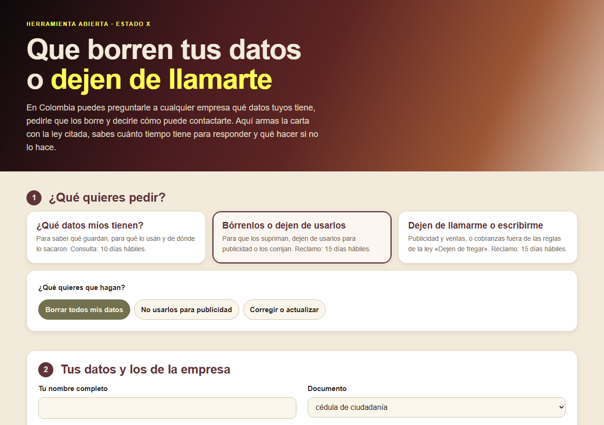

# Que borren tus datos o dejen de llamarte

**[Español](#español) · [English](#english)**

## Español

Herramienta abierta para **armar la carta con la que le pides a una empresa qué datos tuyos tiene, que los borre o que deje de llamarte**, con la ley colombiana citada, el plazo que tiene para responder y qué hacer si no lo hace.

**Ábrela aquí:** https://estado-x.github.io/habeas-data-colombia/

### Qué hace

Escoges qué quieres pedir y la página arma la carta:

| Carta | Para qué | Norma | Plazo |
|---|---|---|---|
| ¿Qué datos míos tienen? | Saber qué guardan, para qué, de dónde los sacaron y a quién se los dieron | Ley 1581 de 2012, arts. 8 y 14 | 10 días hábiles (+5 si avisan) |
| Bórrenlos o dejen de usarlos | Suprimir los datos, revocar la autorización para publicidad, o corregirlos | Ley 1581, arts. 8 y 15; Decreto 1074 de 2015, art. 2.2.2.25.2.6 | 15 días hábiles (+8 si avisan) |
| Dejen de llamarme o escribirme | Publicidad y ventas, o cobranzas fuera de las reglas | Ley 2300 de 2023 («Dejen de fregar»), arts. 2 a 7; Ley 1581, art. 15 | 15 días hábiles (+8 si avisan) |

Luego:

- **Calcula la fecha límite** en días hábiles, con los festivos de Colombia (incluida Semana Santa y los que se corren al lunes).
- Te deja **copiar la carta, abrirla en tu correo o imprimirla y guardarla en PDF**.
- Explica **qué sigue**: dónde encontrar el correo de la empresa (su política de tratamiento o el Registro Nacional de Bases de Datos de la SIC), cómo guardar la prueba, la queja ante la SIC, el Registro de Números Excluidos de la CRC y la Superintendencia Financiera para cobranzas de bancos.

### Cómo funciona

- Es una página estática (HTML, CSS y JavaScript) publicada con GitHub Pages. No tiene servidor ni base de datos, no necesita claves y **no envía a ningún lado** lo que escribes. No guarda nada: al cerrar la página, se borra.
- `assets/cartas.js` tiene el texto de las cartas; `assets/plazos.js` calcula los días hábiles y los festivos; `assets/app.js` es la interfaz. Las pruebas, en `pruebas/`, revisan los festivos de 2026 contra el calendario oficial.
- Los plazos se cuentan desde el día siguiente al envío, de lunes a viernes, sin festivos.

### Úsala o adáptala

1. Haz un fork de este repositorio.
2. Activa GitHub Pages (Settings → Pages → rama `main`, carpeta raíz).
3. Para probarla en tu computador: `python -m http.server` y abre `http://localhost:8000`. Para correr las pruebas: `node --test pruebas/` (Node 18 o superior, sin instalar nada).

Si cambia una norma, el texto está en `assets/cartas.js` y los plazos en `TIPOS`, en el mismo archivo.

### Límites

- Es una guía para ejercer tus derechos, **no asesoría legal**. Para un caso con daños, demandas o una deuda en discusión, consulta a un abogado.
- Los reportes en centrales de riesgo (Datacrédito, TransUnion) tienen sus propias reglas (Ley 1266 de 2008) y otro trámite.
- Pedir que dejen de llamarte por una deuda no borra la deuda: solo pone reglas a cómo te contactan.
- Si tienes un deber legal o contractual de seguir en la base de datos, la empresa puede negarse a borrar ciertos datos, pero debe decirte por qué.
- La página no trae un directorio de empresas: el correo de cada una lo buscas tú.
- La fecha límite es una referencia: si envías el correo fuera del horario de la empresa, puede contarse desde el día hábil siguiente.

### Crédito

- Inspirada en [Datenanfragen.de](https://github.com/datenanfragen/website) (licencia MIT), que hace lo mismo para el reglamento europeo de protección de datos. No reutiliza su código.
- Normas: Constitución Política, art. 15; Ley 1581 de 2012; Decreto 1074 de 2015; Ley 2300 de 2023. Texto consultado en la Secretaría del Senado.

### Hecho por Estado X

[Estado X](https://estadox.com) · Licencia MIT. ¿Eres abogado o abogada? Conoce [IA para Abogados](https://estadox.com/abogados).

---

## English

An open tool to **write the letter that asks a company in Colombia what personal data it holds about you, to delete it, or to stop calling you**, citing Colombian law, with the response deadline and what to do if the company does not answer.

**Open it here:** https://estado-x.github.io/habeas-data-colombia/

### What it does

Three letters: an access request (Law 1581 of 2012, art. 14, 10 business days), a deletion, opt-out or correction claim (art. 15, 15 business days) and a request to stop marketing or abusive debt-collection contact (Law 2300 of 2023, the «Dejen de fregar» law). It computes the deadline in business days with Colombian public holidays, lets you copy the letter, open it in your email or print it to PDF, and explains the next steps (complaint to the SIC, the CRC do-not-call registry, the financial regulator for bank collections).

### How it works

A static page on GitHub Pages: no server, no database, no keys, and **nothing you type leaves your browser**. Tests: `node --test pruebas/`.

### Limits

A guide to exercise your rights, **not legal advice**. Credit-bureau reports follow a different law (Law 1266 of 2008). Asking a collector to change how it contacts you does not cancel the debt.

### Credits

Inspired by [Datenanfragen.de](https://github.com/datenanfragen/website) (MIT), which does the same for the EU GDPR; no code reused.

### Made by Estado X

[Estado X](https://estadox.com) · MIT License.
